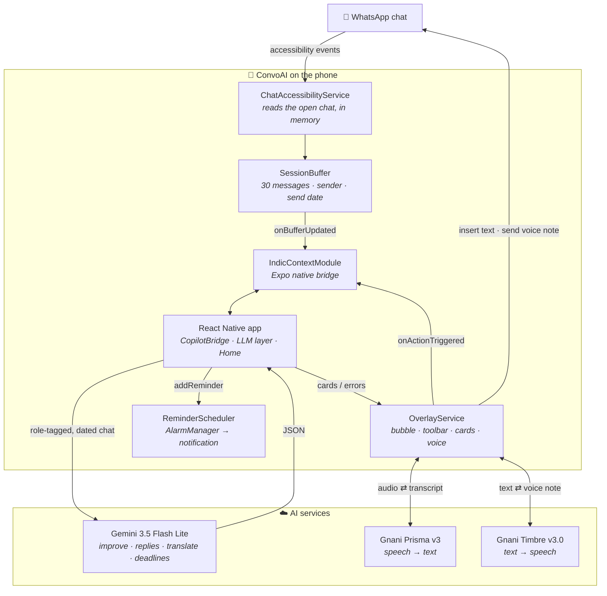
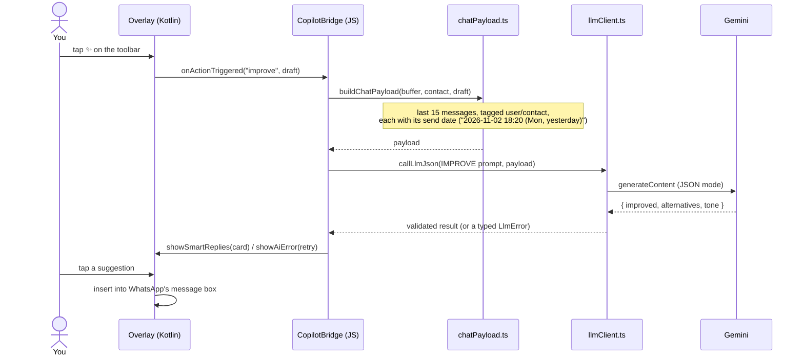
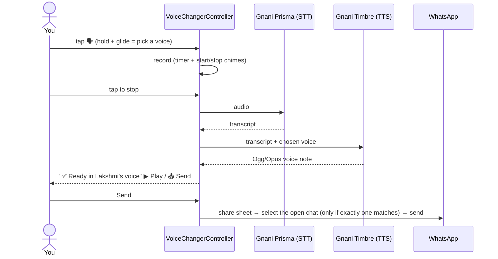
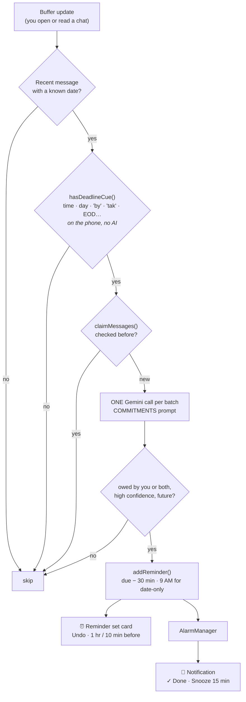

<div align="center">


# ConvoAI

**Your AI assistant that lives inside WhatsApp.**
Write better, in every language, in every chat.


[Features](#-features) · [How it works](#-how-it-works) · [Tech stack](#-tech-stack) · [Getting started](#-getting-started) · [Contributing](#-contributing)

</div>

---

## 📖 About

People in India switch between English, Hindi and Hinglish in the same chat, and the right words depend on **who** you're talking to. A message that's fine for your best friend isn't fine for your manager. Most writing tools only see your draft, so they give everyone the same generic answer.

**ConvoAI** is an Android app that puts a small assistant bubble **right above WhatsApp's message box**. With your permission it reads the chat you have open: who said what, and when. Then it helps you:

- write in the chat's own tone,
- reply,
- translate,
- speak instead of typing,
- send voice notes in a natural Indian voice,
- and keep the promises you make.

Speech runs on **Gnani AI** (Prisma speech-to-text and Timbre text-to-speech). The writing features use **Gemini 3.5 Flash Lite**, with a switch for Gnani Evon.

> Built for the **Gnani AI Internship Hackathon**.

---

## ✨ Features

|     | Feature                          | What it does                                                                                                                                                                                                                                                                               |
| --- | -------------------------------- | ------------------------------------------------------------------------------------------------------------------------------------------------------------------------------------------------------------------------------------------------------------------------------------------ |
| 🫧  | **Smart bubble**                 | Appears **only inside a WhatsApp chat**, just above the message box. It hides everywhere else (chat list, Status, other apps). Drag it to either edge and it remembers the spot. The toolbar closes on any outside touch, and dragging the bubble to the bottom turns ConvoAI off.         |
| ✨  | **Improve**                      | Rewrites your draft to fit the conversation: casual Hinglish with a friend, polite English with your boss. The tone is **inferred from the chat**, never from a contact name or preset. Checks keep your meaning, script and day (“tomorrow”).                                             |
| 💬  | **Smart replies**                | Three replies in the chat's own language and tone. Every message carries its **send date**, so ConvoAI knows that yesterday's “kal subah tak bhej dunga” is overdue this morning and suggests a nudge.                                                                                     |
| 🌐  | **Translate**                    | Hold 🌐 and glide to **English** or **हिन्दी**, then tap. Your draft is replaced with the translation in the right script (Roman Hinglish → Devanagari), in the same tone. Empty or one-word drafts never make an AI call.                                                                 |
| 🎙  | **Dictate**                      | Speak in any of **10 Indian languages**, and **Gnani Prisma** types it into the message box. Hold and glide to switch language.                                                                                                                                                            |
| 🗣  | **Voice notes in another voice** | Record yourself. Gnani Prisma transcribes it, then **Gnani Timbre v3.0** re-speaks your exact words in one of **6 natural voices** (Devansh, Yashraj, Avinash, Lakshmi, Shivani, Riyaa). It's sent to the open chat, and the chat is selected automatically only when exactly one matches. |
| ⏰  | **Deadline reminders**           | “Update me by 6 PM”, “I'll send the review by Monday”. ConvoAI spots deadlines **you owe** in the chats you open and notifies you before they're due (30 min by default; 9:00 AM for “by Monday”). A card offers Undo, and the notification has ✓ Done and Snooze buttons.                 |
| 🏠  | **Home & catch-up**              | On/off switch, live permission checklist, catch-up summary of the open chat, upcoming reminders, speech language and default voice. Follows the system light/dark theme.                                                                                                                   |
| 🎓  | **Interactive tutorial**         | A guided practice chat with a glowing spotlight on the next button to press, voice samples (▶) and plain-language permission steps.                                                                                                                                                        |

### 🔒 Private by design

- **Chats are never stored.** Messages live in a 30-item in-memory buffer. The only things written to disk are the reminders ConvoAI sets.
- **AI runs when you tap.** The one exception is the deadline check, and it's filtered: an on-phone regex lets only messages that mention a time or day through, each message is checked once, and you can switch it off.
- **Phone numbers are masked** before any AI call.
- **No fake answers.** If the AI fails you get a Retry card, never a canned reply.

---

## 🧭 How it works

### Architecture



| Layer                  | Where                                                          | Role                                                                                                                              |
| ---------------------- | -------------------------------------------------------------- | --------------------------------------------------------------------------------------------------------------------------------- |
| **Native (Kotlin)**    | `modules/indic-context/android/`                               | Reads the chat (accessibility service), draws the overlay, records audio, calls Gnani STT/TTS, schedules alarms and inserts text. |
| **Bridge**             | `IndicContextModule.kt` ⇄ `modules/indic-context/src/index.ts` | Typed async functions and events between Kotlin and TypeScript.                                                                   |
| **App (React Native)** | `app/`, `src/`                                                 | Screens, the `CopilotBridge` event hub, the LLM layer, prompts and reminder detection.                                            |

### Flow: ✨ Improve (Smart replies and Translate work the same way)



### Flow: 🗣 Voice note in another voice



### Flow: ⏰ Deadline reminders



More detail is in [`docs/PROJECT_GUIDE.md`](docs/PROJECT_GUIDE.md), a beginner-friendly walkthrough of the whole codebase.

---

## 🛠 Tech stack

| Area               | Technology                                                                                                                                                                                                       |
| ------------------ | ---------------------------------------------------------------------------------------------------------------------------------------------------------------------------------------------------------------- |
| **App**            | [Expo SDK 51](https://docs.expo.dev/), React Native 0.74, React 18, TypeScript (strict), expo-router                                                                                                             |
| **Native**         | Kotlin [Expo module](https://docs.expo.dev/modules/overview/) (`indic-context`), Android AccessibilityService, `TYPE_APPLICATION_OVERLAY` windows, MediaRecorder, AlarmManager, NotificationCompat, FileProvider |
| **Speech-to-text** | **Gnani Prisma v3**: `POST https://api.vachana.ai/stt/v3`, 10 Indian languages                                                                                                                                   |
| **Text-to-speech** | **Gnani Timbre v3.0**: `POST https://api.vachana.ai/api/v1/tts/inference`, 6 voices, Ogg/Opus                                                                                                                    |
| **LLM**            | **Gemini 3.5 Flash Lite** (`generateContent`, JSON mode, thinking levels); **Gnani Evon** or any OpenAI-compatible endpoint, switchable with one env var                                                         |
| **Design**         | [`DESIGN.md`](DESIGN.md) tokens: rose palette, **Poppins**, radius 4/8/12, Bento layout, light and dark themes, reduced-motion support                                                                           |
| **Testing**        | Live prompt eval (`scripts/evalPrompts.ts`), JUnit tests for date parsing and reminder times                                                                                                                     |
| **Showcase**       | [`demo/`](demo/): an animated presentation deck (Vite + React + framer-motion) for the demo video                                                                                                                |

**Android:** min SDK 23 (Android 6.0), target SDK 34. Tested on a real device running Android 15.

---

## 📁 Project structure

```
gnani-pro/
├── app/                          Screens (expo-router)
│   ├── _layout.tsx               Fonts, theme, CopilotBridgeProvider
│   ├── index.tsx                 Home: status, setup, catch-up, reminders, settings
│   └── onboarding.tsx            Interactive tutorial (8 steps)
├── src/
│   ├── hooks/
│   │   ├── CopilotBridge.tsx     The one place overlay events are handled
│   │   └── usePermissions.ts     Live permission status + request helpers
│   ├── services/
│   │   ├── llm/                  llmClient.ts · chatPayload.ts · prompts.ts
│   │   ├── reminders/            deadlineCues.ts · commitments.ts · commitmentDetector.ts
│   │   ├── aiFeatures.ts         Improve, Smart replies, Translate
│   │   └── gnaniEvonLlm.ts       Catch-up summary (+ tone guard, fact check services)
│   ├── ui/                       theme.ts · components.tsx · motion.tsx · VoicePicker · RemindersSection · tutorial/
│   ├── types/context.ts          Shared types (ChatBubble, results…)
│   └── utils/                    constants, contact names, sanitiser (number masking)
├── modules/indic-context/        Local Expo module
│   ├── src/index.ts              The JS API of the native module
│   ├── app.plugin.js             Config plugin (manifest, accessibility config, strings)
│   └── android/src/main/java/com/indiccontext/
│       ├── ChatAccessibilityService.kt   reads WhatsApp, decides bubble visibility
│       ├── OverlayService.kt             bubble, toolbar, cards, glide menus
│       ├── GnaniSttClient.kt · GnaniTtsClient.kt
│       ├── VoiceChangerController.kt · WhatsAppAutoSender.kt
│       ├── Reminder{Store,Times,Scheduler,Receiver}.kt
│       └── IndicContextModule.kt         the bridge
├── scripts/                      evalPrompts.ts (live prompt checks) · generateIcons.py
├── docs/                         Guides and design notes (see below)
├── demo/                         Presentation deck for the demo video
├── DESIGN.md                     Visual design system
└── .env.example                  API keys and provider switch
```

---

## Download & Installation

Tap the badge below to download the latest official APK directly to your Android device:

[](https://github.com/thepiyush-303/gnani-pro/releases/tag/v1.0.0)

_Note: You may need to enable "Install from Unknown Sources" in your Android settings._

## 🚀 Getting started

### Prerequisites

- **Node.js 18+** and npm
- **JDK 17** and the **Android SDK** (Android Studio is the easiest way to get both)
- An **Android phone** with USB debugging on. The overlay and accessibility features are best tested on a real device.
- API keys:
  - a **Gnani** key (Prisma STT and Timbre TTS);
  - a **Gemini** key from [Google AI Studio](https://aistudio.google.com/apikey).

### 1. Install

```bash
git clone https://github.com/thepiyush-303/gnani-pro.git
cd gnani-pro
npm install
cp .env.example .env      # then fill in your keys
```

### 2. Configure `.env`

| Variable                                            | Purpose                                                                          |
| --------------------------------------------------- | -------------------------------------------------------------------------------- |
| `EXPO_PUBLIC_GNANI_API_KEY`                         | Gnani Prisma (STT) and Timbre (TTS)                                              |
| `EXPO_PUBLIC_LLM_PROVIDER`                          | `gemini` (default) or `evon`                                                     |
| `EXPO_PUBLIC_GEMINI_API_KEY`                        | Gemini API key                                                                   |
| `EXPO_PUBLIC_GEMINI_MODEL`                          | Defaults to `gemini-3.5-flash-lite`                                              |
| `EXPO_PUBLIC_EVON_ENDPOINT` / `_MODEL` / `_API_KEY` | Any OpenAI-compatible `/chat/completions` endpoint (when the provider is `evon`) |

> ⚠️ `EXPO_PUBLIC_*` values are **compiled into the app**, so anyone with the APK can extract them. Use restricted or rotating keys for shared builds, and route AI calls through a server before a public release. Restart Metro with `--clear` after editing `.env`.

### 3. Run on your phone

```bash
npm run android            # build + install the dev build (expo run:android)
```

To develop over USB (works even when the phone is on mobile data):

```bash
npm run start:usb          # adb reverse + Metro on localhost
npm run android:usb        # second terminal: open the dev build on the phone
```

### 4. Turn it on

1. Open **ConvoAI**. The tutorial walks you through the permissions:
   - display over other apps;
   - accessibility;
   - microphone;
   - notifications (optional, for reminders).
2. On **Android 13+**, sideloaded apps need **App info → ⋮ → Allow restricted settings** before Accessibility can be switched on.
3. Turn ConvoAI on and open any WhatsApp chat. The bubble appears above the message box.

### Build a shareable APK

```bash
npm run build:apk:share
# → android/app/build/outputs/apk/release/app-release.apk  (signed with the debug key)
```

|                             | Dev build (`npm run android`) | Shareable build (`build:apk:share`) |
| --------------------------- | ----------------------------- | ----------------------------------- |
| JavaScript                  | loaded live from Metro        | bundled in the APK                  |
| Works without your computer | ❌                            | ✅                                  |
| Use for                     | day-to-day development        | testers, demos                      |

The release build is signed with the debug keystore, which is fine for testers and demos. Create a real keystore before publishing to the Play Store.

### Commands

| Command                                                    | What it does                                    |
| ---------------------------------------------------------- | ----------------------------------------------- |
| `npm run android`                                          | Build and install the dev build                 |
| `npm run start:usb` / `npm run android:usb`                | Develop over a USB cable                        |
| `npm run build:apk:share`                                  | Shareable release APK                           |
| `npx tsc --noEmit`                                         | Type check                                      |
| `cd android && ./gradlew :indic-context:testDebugUnitTest` | Kotlin unit tests                               |
| `npm run eval:prompts`                                     | Live prompt regression checks (uses API quota)  |
| `npx expo prebuild --platform android --no-install`        | Apply `app.json` / plugin changes to `android/` |

---

## 🧪 Testing

- **Type safety:** `npx tsc --noEmit` must pass. TypeScript runs in strict mode.
- **Native unit tests:** `ChatDatesTest` covers WhatsApp date labels and 12h/24h times. `ReminderTimesTest` covers lead time, the 9 AM rule and past deadlines.
- **Prompt eval:** `npm run eval:prompts` calls the configured LLM with fixture chats in English, Hinglish and Hindi. It checks for:
  - formal vs banter rewrites, and slang appearing in formal chats;
  - replies that ignore what's due, or generic “how are you” check-ins;
  - Devanagari output, and tone kept in translation;
  - reminders that are yours vs the contact's, already done, or past.

  Raise the delay between calls with `EVAL_PACE_MS=9000` if you hit free-tier rate limits.

- **On the device:** see the checklists in [`docs/UI_REDESIGN.md`](docs/UI_REDESIGN.md) and [`docs/REMINDERS.md`](docs/REMINDERS.md). For debugging, the reminder pipeline writes every step to the phone's log:

  ```bash
  adb logcat | grep -E "ConvoAI.JS|ReminderScheduler|ChatA11y"
  ```

---

## 🤝 Contributing

Contributions are welcome: bug reports, prompt improvements, new languages and UI polish.

### Workflow

1. **Open an issue first** for anything bigger than a small fix, so we can agree on the approach.
2. **Fork** the repo and create a branch from `main`, for example `feature/telegram-overlay` or `fix/bubble-keyboard-overlap`.
3. Make focused commits with clear messages. [Conventional Commits](https://www.conventionalcommits.org/) are encouraged: `feat: add Tamil to translate`, `fix: date divider parsing on Android 15`.
4. Open a pull request against `main`. Describe **what** changed and **why**, and include screenshots or a short screen recording for anything visual.

### Ground rules for the code

| Rule                                                                                                                                | Why                                                                         |
| ----------------------------------------------------------------------------------------------------------------------------------- | --------------------------------------------------------------------------- |
| **All LLM calls go through `src/services/llm/llmClient.ts`** (`callLlmJson` + a validator).                                         | One place for timeouts, typed errors and the provider switch.               |
| **No canned or template fallbacks.** Throw an `LlmError` and let the UI show Retry.                                                 | Users must know when the AI failed.                                         |
| **No persona or relationship presets.** The tone is inferred from the conversation in the prompt.                                   | Guessing from names is unreliable.                                          |
| **AI runs only on a user action.** The filtered deadline detector is the single exception.                                          | Quota, privacy and no surprise popups.                                      |
| **Never write chat messages to disk.** Reminders are the only stored data.                                                          | Privacy promise.                                                            |
| **Overlay events are handled only in `src/hooks/CopilotBridge.tsx`.**                                                               | One event hub, so features work on any screen.                              |
| **Don't use `setTimeout` in code that runs while WhatsApp is in front.**                                                            | React Native pauses JS timers when ConvoAI's activity is in the background. |
| **Styling uses `src/ui/theme.ts` tokens** (`font.*` carries `fontFamily`; never `fontWeight`) and follows [`DESIGN.md`](DESIGN.md). | Consistent look; Android needs one font family per weight.                  |
| **Log with `IndicContext.debugLog`** where logs must appear in release builds (logcat tag `ConvoAI.JS`).                            | `console.log` isn't visible in release logcat.                              |
| **Never commit `.env`** or API keys.                                                                                                | Secrets.                                                                    |

### Before you open a pull request

- [ ] `npx tsc --noEmit` passes.
- [ ] `cd android && ./gradlew :indic-context:testDebugUnitTest` passes if you touched Kotlin.
- [ ] `npm run eval:prompts` passes if you changed a prompt or the payload, and you've added a fixture for the new behaviour.
- [ ] You tested on a real phone: the bubble appears only in chats, the toolbar closes on an outside touch, and your feature works in both light and dark mode.
- [ ] You updated the docs (`docs/CLAUDE.md`, `docs/PROJECT_GUIDE.md` or the feature's doc) if behaviour changed.

### Reporting bugs

Please include:

- your phone model and Android version;
- your WhatsApp version;
- the steps to reproduce;
- what you expected and what happened;
- the output of `adb logcat | grep -E "ConvoAI.JS|ChatA11y|OverlayService"`.

**Remove any private chat text from the logs before posting.**

---

## 📚 Documentation

| Doc                                              | Contents                                                                          |
| ------------------------------------------------ | --------------------------------------------------------------------------------- |
| [`docs/PROJECT_GUIDE.md`](docs/PROJECT_GUIDE.md) | Beginner-friendly guide to the whole project: architecture, data flow, every file |
| [`docs/CLAUDE.md`](docs/CLAUDE.md)               | Commands and conventions for contributors and AI coding agents                    |
| [`docs/AI_OVERHAUL.md`](docs/AI_OVERHAUL.md)     | Design of the LLM layer: role-tagged payloads, no personas, validation            |
| [`docs/VOICE_CHANGER.md`](docs/VOICE_CHANGER.md) | 🗣 Voice notes: recording, Prisma → Timbre, guarded auto-send                     |
| [`docs/REMINDERS.md`](docs/REMINDERS.md)         | ⏰ Deadline reminders: pipeline, rules, privacy, debugging                        |
| [`docs/UI_REDESIGN.md`](docs/UI_REDESIGN.md)     | UI system, accessibility contrast notes, on-device checklist                      |
| [`DESIGN.md`](DESIGN.md)                         | Design tokens: colours, type, spacing, motion                                     |
| [`demo/README.md`](demo/README.md)               | The presentation deck for the demo video                                          |

---

## 🗺 Roadmap

- 🛡 **Scam and fraud detection:** flag suspicious messages (urgent KYC, OTP or payment requests, unknown senders, shortened links) before anyone shares an OTP or pays.
- 💬 **Every channel:** Telegram, Slack, Discord, Instagram DMs, Microsoft Teams, Gmail and more, with one assistant that remembers your tone.
- 🌏 **More languages** for Improve and Translate, beyond English and Hindi.
- 🔐 **Server-side AI proxy**, so no API keys ship inside the APK.

---

## 🙏 Acknowledgements

- **[Gnani AI](https://www.gnani.ai/)** for Prisma (speech-to-text) and Timbre (text-to-speech), and for hosting the internship hackathon.
- **Google Gemini** for the language model behind the writing features.
- **[Expo](https://expo.dev/)** and **React Native** for the app framework.
- **[Poppins](https://fonts.google.com/specimen/Poppins)** by the Indian Type Foundry, and the **[Material Design Icons](https://pictogrammers.com/library/mdi/)**.

## 📄 License

This repository doesn't include a license yet. Until one is added, all rights are reserved by the author. Please open an issue if you'd like to use or redistribute the code.

<div align="center">

Made with ❤️ in India by **[@thepiyush-303](https://github.com/thepiyush-303)**

</div>
